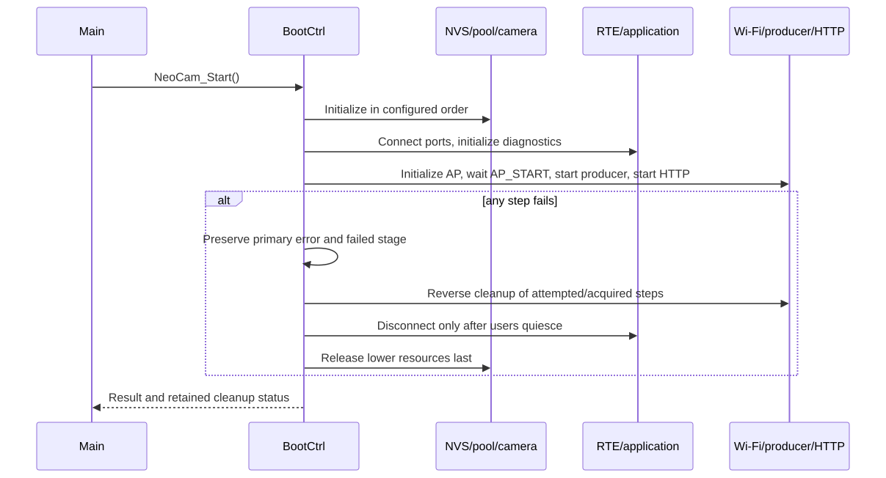
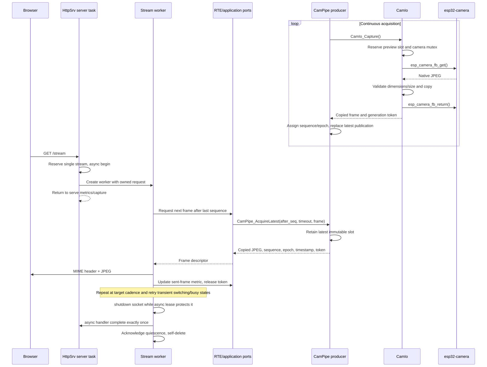
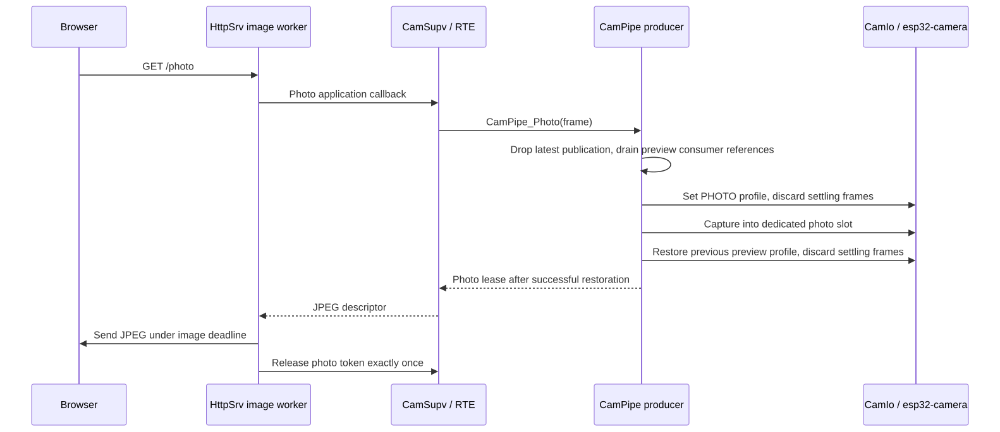

NeoCam camera-demo architecture
===============================

This implementation extends the VGA/SoftAP demo with fixed preview profiles and
OV3660 full-resolution photos using the agreed reference hierarchy.
ESP-IDF 6.0.1, camera 2.1.7 and JPEG 1.3.1 are the pinned backends.
The reference workbook taxonomy is retained; NeoCam-specific packages are additions.
No unused Spi/I2c/NvM, recording, microphone, or SD implementation is claimed.

Module registry and specification profile
-----------------------------------------

+----------------------------+---------------------------+----------------------+
| Package                    | Interface/ownership       | Classification       |
+============================+===========================+======================+
| Infrastruc/CUCEL/Platform, | CPU/endian/types,         | R24-11 standard-type |
| Standard                   | returns, switches and     | subset; no project   |
|                            | version structure         | types added to       |
|                            |                           | Platform_Types.h     |
+----------------------------+---------------------------+----------------------+
| Infrastruc/CUCEL/MemMap    | Repeated section markers, | Selected             |
|                            | invalid/nested/mismatched | memory-mapping       |
|                            | transition diagnostics    | pattern adapted to   |
|                            |                           | GCC/ESP-IDF linker   |
|                            |                           | sections             |
+----------------------------+---------------------------+----------------------+
| Infrastruc/BootCtrl        | Serialized start/stop of  | Project lifecycle    |
|                            | configured steps; primary | adapter, not EcuM or |
|                            | and cleanup failures      | AUTOSAR OS startup   |
+----------------------------+---------------------------+----------------------+
| Infrastruc/BswLib/MediaBuf | Owns reference-counted    | NeoCam extension;    |
|                            | preview/photo slots and   | independent of NvM   |
|                            | persistent generation     | and MemMap           |
|                            | tokens                    |                      |
+----------------------------+---------------------------+----------------------+
| SysSrv/EbOs                | Opaque mutexes; task      | FreeRTOS adapter,    |
|                            | delay                     | not an AUTOSAR OS    |
|                            |                           | implementation       |
+----------------------------+---------------------------+----------------------+
| SysSrv/LocalTime           | Monotonic microseconds    | NeoCam extension;    |
|                            |                           | not synchronized     |
|                            |                           | StbM time            |
+----------------------------+---------------------------+----------------------+
| CDD/CamIo                  | Owns camera/SCCB backend  | CDD adaptation using |
|                            | and serialized native     | esp32-camera         |
|                            | frame acquisition         | directly             |
+----------------------------+---------------------------+----------------------+
| CDD/CamPipe                | Single acquisition        | NeoCam CDD           |
|                            | producer, latest          | extension; no        |
|                            | publication, mode/photo   | standard AUTOSAR     |
|                            | state machine, timing and | camera API claimed   |
|                            | resource sampling         |                      |
+----------------------------+---------------------------+----------------------+
| ComStack/WifiStack/WifiIf  | Owns AP netif, event      | ESP-IDF adapter      |
|                            | registration, Wi-Fi       |                      |
|                            | lifecycle and native      |                      |
|                            | diagnostics               |                      |
+----------------------------+---------------------------+----------------------+
| ComStack/WifiStack/WifiMgr | Validates C               | NeoCam extension;    |
|                            | configuration; waits for  | not 802.11p WEth     |
|                            | AP start/stop events      |                      |
+----------------------------+---------------------------+----------------------+
| ComStack/WifiStack/HttpSrv | Owns server, one async    | NeoCam HTTP          |
|                            | stream and one async      | transport extension  |
|                            | image worker, socket      |                      |
|                            | leases and absolute send  |                      |
|                            | deadlines                 |                      |
+----------------------------+---------------------------+----------------------+
| CamApp/ASW/CamHmi          | Dashboard, capture policy | Application          |
|                            | and HTTP application      | component            |
|                            | ports                     |                      |
+----------------------------+---------------------------+----------------------+
| CamApp/ASW/CamDiag         | Metrics and JSON schema,  | Application          |
|                            | serialized through RTE    | component            |
|                            | diagnostic mutex          |                      |
+----------------------------+---------------------------+----------------------+
| CamApp/DE/CamDev           | Camera device operations  | Device encapsulation |
|                            | mapped to BSW through RTE |                      |
+----------------------------+---------------------------+----------------------+
| CamApp/ASV/CamSupv         | Validates requested       | Application service; |
|                            | profile names;            | command execution    |
|                            | photo/profile application | belongs to CamPipe   |
|                            | ports and status JSON     |                      |
+----------------------------+---------------------------+----------------------+
| Rte                        | Typed, statically wired   | Hand-written         |
|                            | provider/client ports     | adaptation, no       |
|                            |                           | ARXML/RTE generator  |
+----------------------------+---------------------------+----------------------+
| Conf/\__CONFIG             | Composition and           | C source, compiled   |
|                            | startup-step tables       | with the main        |
|                            |                           | composition          |
|                            |                           | component            |
+----------------------------+---------------------------+----------------------+
| GConf/CameraProfiles       | One immutable table for   | Hand-written project |
|                            | backend, application and  | configuration        |
|                            | diagnostics               |                      |
+----------------------------+---------------------------+----------------------+

Standards references: `Platform Types <https://www.autosar.org/fileadmin/standards/R24-11/CP/AUTOSAR_CP_SWS_PlatformTypes.pdf>`__,
`Standard Types <https://www.autosar.org/fileadmin/standards/R24-11/CP/AUTOSAR_CP_SWS_StandardTypes.pdf>`__,
`Memory Mapping <https://www.autosar.org/fileadmin/standards/R24-11/CP/AUTOSAR_CP_SWS_MemoryMapping.pdf>`__,
`BSW General <https://www.autosar.org/fileadmin/standards/R24-11/CP/AUTOSAR_CP_SWS_BSWGeneral.pdf>`__.
These define the selected conventions; the project does not claim full module or
methodology conformance. Legacy Compiler.h abstraction, standard EcuM startup,
AUTOSAR OS, SchM generation and full driver suites are not implemented.

Selected requirement anchors: Platform_00002 (no project extensions), Platform_00044
(CPU width), Platform_00046 (byte order), Platform_00026/00027/00034 (boolean), and
Platform_00041/00042 (floating-point representations). Common headers use the exact
standard spellings; project errors, media descriptors and port tables stay in GLOBAL.
Full transformer/message definitions from Std_Types are outside this demo's subset.

The workbook's Mcal is directly under BSW, separate from IoServices. WifiStack is
a NeoCam addition. A future standard Spi driver belongs under Mcal/Spi_STC/Spi;
the camera currently uses SCCB and parallel DVP, not SPI image transport. The
vendor library's internal SCCB transactions remain inside the CDD boundary.

Dependencies and execution
--------------------------

   Product dependencies and application port wiring.

:download:`Editable Mermaid source <diagrams/dependencies.mmd>`

Function-pointer connections are installed at startup. They permit calls into the
application without a BSW-to-application header/build dependency. Three grouped
IDF components plus main use explicit source lists; package does not mean task.

The IDF HTTP server task handles page, metrics and profile control. Separate bounded
async workers handle the stream and a single capture/photo response. The CamPipe
producer is the only native acquisition caller after startup. SDK camera/Wi-Fi/network
tasks remain backend details. The stream requests a strictly newer sequence and
uses the profile's target cadence with carried absolute deadlines; missed send
opportunities are skipped. There is no catch-up queue or repeated old frame.

All lifecycle calls require one serialized composition owner and quiescent users
before destruction. Data-path calls may run concurrently. Camera acquisition uses
a task mutex, never a CPU critical section. Network sends never hold that mutex or
the pool/diagnostic mutexes. ISR code never calls these application interfaces.

Configuration and memory
------------------------

Module-local Cfg.h/Cfg.c own editable settings. Conf/\__CONFIG owns wiring; GLOBAL
owns project contracts, CONFIG/MemMap_Conf owns section attributes, and TOOLCONF
owns build checks. There are no ECUC values files or generator requirements.
The SDK's sdkconfig.defaults owns only backend build parameters.

Neo_StatusType carries project results: parameter/state/busy/memory/I/O/timeout/
too-large/not-ready. It does not change the meaning of Std_ReturnType. Native errors
are logged privately; WifiIf also retains its first native error for diagnostics.

MemMap maps configured constants to ``.rodata.neocam``, which the IDF linker places
in flash DROM. Module and pool metadata use internal DRAM BSS. Runtime payloads are
allocated explicitly with ``MALLOC_CAP_SPIRAM | MALLOC_CAP_8BIT``; this is CPU-copy
memory, not a promise of DMA suitability. Driver/DMA buffers stay driver-owned.
Run ``python3 TOOLCONF/check_build.py`` to inspect the actual map/configuration.

Four 512 KiB preview slots and one dedicated 1 MiB photo slot are allocated at startup
and freed only with zero live leases. Native JPEG buffers are separately configured
as two 1 MiB buffers: approximately 5 MiB of payload capacity in total, before
driver/network/allocator overhead. Actual heap headroom must be measured on the board.
The default keeps CPU 160 MHz, PSRAM 40 MHz and PSRAM DMA disabled. Experimental
overlays are isolated from that baseline; see :doc:`/validation/optimization`.
A token contains a slot and generation. Generations survive service restart
and never wrap to an old token: a slot that reaches UINT32_MAX becomes unavailable.
A lease transfers only on successful acquisition. CamPipe retains the latest
publication; each consumer receives its own reference and releases once after send
success or failure. Replacing the latest frame releases only the publisher reference.
Copied JPEGs stay immutable while referenced. The backend and SDK may still allocate
dynamically; this is not static AUTOSAR memory allocation throughout the SDK.

.. _neocam-runtime-sequences:

Sequences
---------

.. _neocam-startup-sequence:

   Product startup and rollback sequence.

:download:`Editable Mermaid source <diagrams/startup.mmd>`

The failed step is included in rollback because its own partial cleanup can fail.
Cleanup stops at an unquiesced/failing resource, retaining lower dependencies for a
later NeoCam_Stop() retry. Start is rejected while resources remain active.
ESP-IDF already starts FreeRTOS before app_main; this is not EcuM_Init/StartOS.
NVS full/incompatible errors are reported without erasing storage.

   Preview publication and stream delivery.

:download:`Editable Mermaid source <diagrams/preview.mmd>`

Capture retains the latest preview using the same lease rules in the image worker.
Additional streams or image requests return 503. Capture pool pressure returns 503;
a stream yields and retries. Oversized/invalid frames are returned to the native driver and fail.
Send failures release copied slots and do not increment camera-failure metrics.

   Photo capture, restoration and delivery.

:download:`Editable Mermaid source <diagrams/photo.mmd>`

Profile POST admits one command and returns 202 before execution. The producer drops
its publication and waits for old preview references before reinitializing the sensor.
Warm-up requires three fresh, correctly sized frames within its deadline; duplicate
native timestamps are discarded without counting toward those three frames.
Each successful profile-setting call advances the epoch before warm-up, including
restoration. An epoch alone does not establish successful settling or qualification.
A failed change attempts to restore the
previous profile; restoration failure enters ERROR and remains visible in status.
Commands are serialized with photos. A timed-out photo caller never owns a late result;
the producer releases it and still attempts preview restoration. Native acquisition
can block beyond a nominal operation deadline by one backend call; cleanup never
forcibly frees memory still in use.

Shutdown sets the stopping flag, rejects new work, and waits up to the configured
10 s for both async workers. Timeout retains the entire server and dependencies;
no task/buffer is forcibly destroyed. Once the worker is quiescent, httpd_stop()
joins the synchronous server task before ports, camera, pool or Wi-Fi are released.
The deadline governs async quiescence, not a forced deadline on httpd_stop(). Each
stream frame has one absolute 500 ms send deadline; each image response has 5 s
after its acquisition callback returns. Acquisition/restoration time is separate,
so this is not a five-second deadline for the whole photo request.
Nonblocking sends/select avoid resetting that deadline for every partial write.
After HTTP quiesces, composition stops the producer before camera/pool destruction.

Subsequent work
---------------

The original targets for video/audio recording, SD, STA preview, Mesh and power
remain unimplemented. Add their real consumers before standard driver modules;
do not represent native SCCB or SDSPI traffic as Spi/I2C calls that do not occur.
Recording can add a real bounded consumer to the timestamped producer, retaining the
public ownership contract and defining its own backpressure/drop policy.
